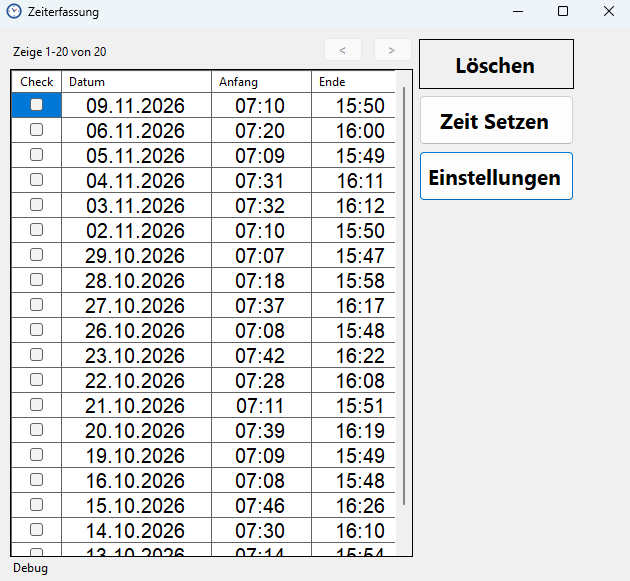
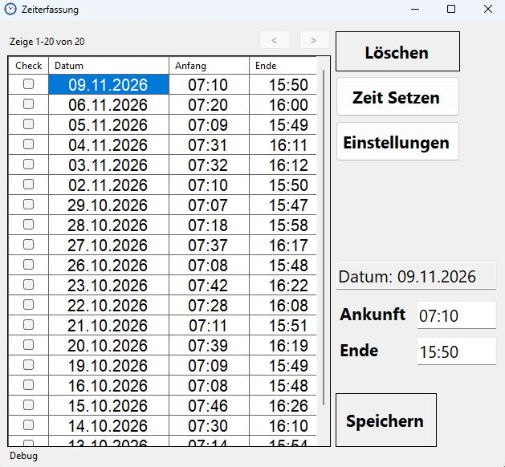
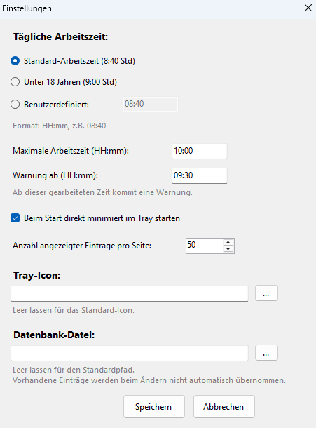

# Zeiterfassung

Kleine Windows-Anwendung, mit der ich während meiner Ausbildung meine Arbeitszeiten erfasst habe. Sie läuft im Infobereich der Taskleiste, speichert beim Start automatisch die Ankunftszeit, berechnet das voraussichtliche Arbeitsende und warnt rechtzeitig, bevor die maximale Arbeitszeit erreicht ist.



## Funktionen

- **Automatische Erfassung:** Beim ersten Start am Tag wird die Ankunftszeit gespeichert und das Arbeitsende berechnet.
- **Symbol in der Taskleiste:** Ankunft und Ende sind per Mauszeiger auf dem Symbol sichtbar; über das Menü lassen sich die Zeiten setzen, die „Gehen“-Zeit speichern, Einstellungen öffnen oder die Übersicht anzeigen.
- **Warnung vor der Höchstarbeitszeit:** Eine Benachrichtigung erscheint eine einstellbare Zeit vor Erreichen der maximalen Arbeitszeit.
- **Übersicht mit Bearbeiten und Löschen:** Alle Einträge in einer Tabelle mit Seitenweise-Blättern; Zeiten lassen sich korrigieren oder löschen.
- **Einstellungen:** Arbeitszeit pro Tag (Vorlagen für Angestellte und Azubis unter 18 oder frei wählbar), maximale Arbeitszeit, Vorwarnzeit, Speicherort der Datenbank und eigenes Symbol.

## Ansichten

| Eintrag bearbeiten | Einstellungen |
| --- | --- |
|  |  |

## Technik

| Bereich | Umsetzung |
| --- | --- |
| Sprache / Framework | C#, .NET 10, Windows Forms |
| Datenhaltung | SQLite (`Microsoft.Data.Sqlite`), ausschließlich parametrisierte Abfragen |
| Einstellungen | JSON-Datei (`System.Text.Json`) im lokalen AppData-Ordner |

## Starten

Voraussetzung: Windows und das [.NET 10 SDK](https://dotnet.microsoft.com/download) bzw. Visual Studio.

```bash
git clone https://github.com/LeonMertens/Zeiterfassung.git
cd Zeiterfassung
dotnet run --project Zeiterfassung_NEU
```

Oder `Zeiterfassung_NEU.slnx` in Visual Studio öffnen und mit F5 starten.

## Speicherorte

- Datenbank: `%LOCALAPPDATA%\Zeiterfassung_NEU\zeiten.db` (in den Einstellungen änderbar)
- Einstellungen: `%LOCALAPPDATA%\Zeiterfassung_NEU\settings.json`
